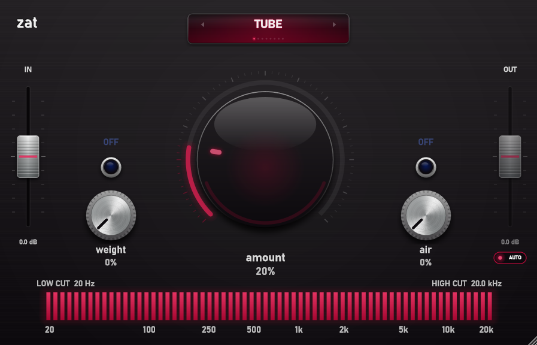

# Zat

Este es un plugin de saturación de audio desarrollado con el framework JUCE, que permite un control fino de la coloración armónica.

## Prestaciones

- **Selector de modelos de saturación**: navegación rápida mediante flechas o menú desplegable para alternar entre distintos algoritmos de saturación.
- **Controles de realce**: combinando excitación armónica con ecualización, se permite aplicar realces en agudos y en graves.
- **Control del rango de frecuencia**: barra gráfica segmentada en con selectores deslizantes de corte de graves (*Low Cut*) y agudos (*High Cut*) para procesar rangos específicos de frecuencia.
- **Gain staging integrado**: vúmetros de entrada y salida con ganancia ajustable y función *Auto-Gain*.

## Parámetros modificables

- **Amount (Cantidad)**: controla la intensidad general de la saturación aplicada, controlando varios parámetros a la vez.
- **Type (Modelo)**: selección del algoritmo de saturación principal.
- **Weight (Graves)**: control para el realce en bajas frecuencias, con interruptor de activación independiente (*ON/OFF*) y potenciómetro de cantidad.
- **Air (Agudos)**: control para el realce en altas frecuencias, con interruptor de activación independiente (*ON/OFF*) y potenciómetro de cantidad.
- **Filtros de corte**:
  - **Low Cut**: filtro *high-pass*.
  - **High Cut**: filtro *low-pass*.
- **Gain y Auto-Gain**: controles de ganancia de entrada y de salida. El modo *auto* permite ajustar la ganancia de salida automáticamente para mantener el nivel de entrada luego de saturar.

## Formatos disponibles

El efecto está disponible como plugin en formato **VST3** y como **Standalone**.